# Karty RPG

Aplikacja przeglądarkowa do projektowania i drukowania kart do gier RPG i planszowych.
Specyfikację znajdziesz w [`SPEC.md`](SPEC.md). Plany opisują [interfejs](docs/plan-UI.md),
[M2](docs/plan-M2.md), [M2b](docs/plan-M2b.md), [M2c](docs/plan-M2c.md), [M3](docs/plan-M3.md)
i ukończone [M4](docs/plan-M4.md).

**Aplikacja online:** <https://fronek82.github.io/karty-rpg/>. Działa w całości w przeglądarce;
projekty zostają na Twoim komputerze (IndexedDB).

**Instrukcja** (PL i EN, zrzuty ekranu): przycisk „Instrukcja” na pasku górnym albo bezpośrednio
<https://fronek82.github.io/karty-rpg/instrukcja/> (`?lang=pl` / `?lang=en`). To osobna, statyczna
strona (bez Reacta), z tym samym przełącznikiem języka i motywu co aplikacja.

## Ekran startowy

Wybierz **„Stwórz karty do Mausrittera”** lub **„Stwórz własne karty”**. Pośrodku są **„Moje projekty”**,
a panel importu pozwala wybrać lub upuścić pliki projektów i szablonów.

Przyciski **PL / EN** i **Motyw jasny / Motyw ciemny** znajdują się na pasku górnym.
Wybór pamięta przeglądarka i korzysta z niego również instrukcja. Bez zapisanego wyboru aplikacja
używa polskiego w polskiej przeglądarce, angielskiego w pozostałych i motywu systemowego.

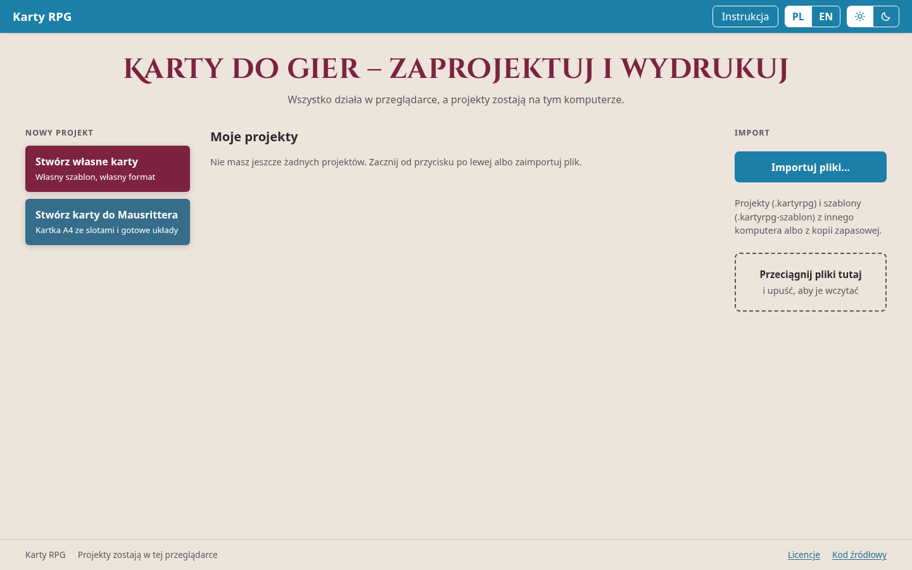

[Galeria ekranów po polsku i po angielsku, w obu motywach](docs/obrazy/ui-9/README.md).

## Jak zacząć (Mausritter)

1. Na starcie wybierz **„Stwórz karty do Mausrittera”**, potem **„Pusta kartka”** albo
   **„Zacznij od gotowego układu”** (Broń i pancerze / Wyposażenie / Stany / Wszystkie trzy).
2. Na kartce A4 **kliknij pusty slot** i wybierz typ karty (broń, zbroja, ekwipunek, zaklęcie,
   stan, pusta karta). Karta pojawia się w domyślnym rozmiarze dla typu.
3. **Kliknij kartę** – w panelu z prawej edytujesz jej pola, rozmiar i ilustrację (także zdjęcia
   z telefonu). Shift + klik albo prostokąt zaznaczają kilka kart – wspólne pola zmieniasz naraz.
4. Karty **przeciągasz myszą**, także na kolejną stronę. **„Duplikuj”** dodaje jedną kopię.
   **„Liczba kopii”** obejmuje oryginał i kopie. Zmień ją strzałkami, zatwierdź Enterem lub opuść pole.
   Na arkuszu stanów dodasz **nagłówek grupy** nad kolumnami.
5. **Ustawienia**: tytuł kartki, czarno-biały, papier, czcionki (także własne i katalog Google Fonts),
   druk dwustronny oraz tryb drukarni.
6. **Pobierz PDF** i drukuj w **skali 100%** (bez „dopasuj do strony”). **Eksportuj** zapisuje
   projekt do pliku `.kartyrpg` (kopia zapasowa, przeniesienie na inny komputer – import na starcie).

## Własne karty (od zera)

1. Na starcie **„Stwórz własne karty”**. Ekran ma po lewej **„Nowy szablon od zera”** i **„Importuj szablon”**, a pośrodku
   kafelki z podglądem: **Pusta karta** i przykładowe szablony (karta z opisem, blok statystyk, karta z rzędem
   wartości, karta ozdobna, karta swobodna). Kliknięcie kafelka tworzy projekt z szablonem i jedną kartą
   z danymi przykładowymi. **„Nowy szablon od zera”** otwiera kreator: nazwa, format karty
   (Poker, Bridge, Mini Euro, Mini American, Tarot, kwadrat albo własny w mm), orientacja, rogi,
   kolor i neutralny układ startowy.
2. **Edytor szablonu**: z lewej drzewo wierszy, kolumn i pól (**＋ Dodaj**, ↑/↓, do kontenera,
   opakuj, duplikuj, usuń; klawiatura), w środku podgląd karty (klik zaznacza element), z prawej
   **właściwości**: typ, nazwa, treść z danych karty albo stała, etykieta, szerokość i wysokość,
   styl tekstu, tło, ramka, odstępy, kształt wartości, tabela (kolumny, wiersze, nagłówki, linie).
   Shift + klik zaznacza kilka elementów. Przeciągaj pola między kontenerami, a w kontenerze
   swobodnym zmieniaj wspólny rozmiar zaznaczenia uchwytami lub w panelu. Przycisk **„Duplikuj szablon”**
   udostępnia kopię do dalszej edycji.
3. **„Rób karty ►”** – kartka dla rozmiaru szablonu; klik w slot dodaje kartę, panel pokazuje pola
   z nazwami z szablonu. W treści pól działa formatowanie: `**pogrubienie**`, `*kursywa*`,
   `***oba***` (`\*` – zwykła gwiazdka). **„Edytuj szablon”** wraca do edytora.
4. Papier: A4, Letter, A5, zdjęcia 10×15 / 13×18 / 15×21 cm (strefa bezpieczeństwa 3 mm) albo
   własny. Szablon eksportuje się do pliku `.kartyrpg-szablon` i importuje w innym projekcie.

### Globalna biblioteka szablonów i ozdobników

1. W **Ustawieniach** otwórz **Szablony projektu** i wybierz **„Zapisz w bibliotece globalnej”**
   przy własnym szablonie. Ozdobnik zapiszesz tym samym przyciskiem w **Bibliotece ozdobników**.
2. Rozwiń odpowiednią bibliotekę globalną w projekcie docelowym i wybierz **„Użyj”**.
   Katalog szablonów na ekranie **„Stwórz własne karty”** pozwala też utworzyć nowy projekt.
   Własny szablon dodany do projektu pakietowego otrzymuje osobną kartkę z własnym menu kart.
3. Katalog jest wspólny dla projektów w jednej przeglądarce. Użycie wpisu tworzy kopię w projekcie.
   Zapisz wybrany wpis przyciskiem **„Eksportuj”**, a w innej przeglądarce wczytaj plik przyciskiem
   **„Importuj do biblioteki…”**. Pliki mają rozszerzenia `.kartyrpg-szablon` i `.kartyrpg-ozdobnik`.

[Zrzuty biblioteki, wymiarów i menu eksportu w PL i EN, w obu motywach](docs/obrazy/m2c-4/README.md).

### Druk poza zwykłym A4

- **Własny układ arkusza** (Ustawienia → „Układ arkusza”): stała siatka kolumny × rzędy,
  margines górny i lewy, rozmiar karty i odstępy między kartami – np. gotowe arkusze z perforacją.
  Rozwiń **„Podgląd wymiarów”**, aby zobaczyć wymiary papieru, slotu, marginesów i odstępów.
  Kliknij podkreśloną liczbę przy strzałce lub użyj klawiatury na liście wymiarów, aby przejść do pola
  formularza. Przycisk **„Zapisz jako mój układ”** dodaje układ do wspólnej listy w tej przeglądarce.
- **Kalibracja drukarki**: przesunięcie X/Y w mm (zapamiętane w przeglądarce, tylko PDF)
  i **„Wydruk testowy (PDF)”** – same obrysy kart z numerami i krzyżykami; drukuj w skali 100%.
- W menu **„Pobierz”** wybierzesz PDF oraz obrazy stron lub kart w JPG i PNG. Obrazy mają
  wymiary odpowiadające 300 dpi. Przy pojedynczym obrazie otrzymasz plik, a przy kilku plik ZIP.
  Formaty fotograficzne 10×15 / 13×18 / 15×21 cm mają strefę przycięcia 3 mm.

Po aktualizacji odśwież kartę aplikacji otwartą w poprzedniej wersji przed ponownym otwarciem
projektu lub paczki zapisanej przez nową wersję.

Przykładowe szablony do wypróbowania (do testów, nie gotowe pakiety gier):
[`docs/przyklady/`](docs/przyklady/).

## Skład kart i import tabel

- W edytorze szablonu możesz przypisać kilka pól do jednej grupy stylu. Kolory karty, panelu i etykiety
  mogą wynikać z wartości pola danych. Pole tekstowe obsługuje listę numerowaną, ikony `:star:`
  i `:scissors:` oraz podział długiego opisu na dalsze karty.
- W kontenerze swobodnym wpisz kąt obrotu w sekcji „Położenie”. Na kartce z mieszanymi rozmiarami
  „Pakowanie kart” pozwala wybrać pasy lub MaxRects.
- Pod kartką wybierz **„Importuj CSV lub XLSX”**, wskaż szablon i plik, przypisz kolumny i sprawdź
  podgląd przed dodaniem kart. CSV zapisuj w UTF-8 z przecinkiem albo średnikiem. Pierwszy niepusty
  wiersz dostarcza nagłówki. Pusta ilość oznacza jedną sztukę. Ilustracje dopasowują się po
  jednoznacznej nazwie obrazu w bibliotece projektu. Cofnięcie usuwa całą dodaną partię.

[Neutralne przykłady M3 w PL i EN, w obu motywach](docs/obrazy/m3-8/README.md).

## Rewersy, druk dwustronny, tryb drukarni i Google Fonts

- **Rewersy**: w **Ustawieniach → Rewersy** utworzysz własne rewersy w edytorze warstw
  (tło i tekstura PNG/JPG w czterech trybach dopasowania z kryciem i zabarwieniem, napisy także po
  łuku w górę lub w dół, grafiki, obrót i krycie warstw, ramki i narożniki). Rewers przypiszesz na
  trzech poziomach z dziedziczeniem: **talia → szablon → konkretna karta** (jawny wybór **„Bez
  rewersu”** zatrzymuje dziedziczenie). Eksport paczki szablonu przenosi przypisany rewers wraz z jego
  zasobami.
- **Druk dwustronny**: w **Ustawieniach → Druk dwustronny** włączysz pary stron przód / lustrzany
  tył (także przy mieszanych rozmiarach, nakładzie, pustych polach i kontynuacjach) z wyborem
  **krawędzi odwracania** (długa lub krótka). Osobna lokalna **Korekta rewersu X / Y (mm)** i
  **„Wydruk próbny dwustronny (PDF)”** z krzyżykami oraz strzałkami góry pozwalają wyrównać drukarkę
  pod światło.
- **Tryb drukarni**: w **Ustawieniach → Tryb drukarni** dodasz **spad** (0–10 mm, domyślnie 3 mm),
  **znaczniki cięcia** i wybierzesz układ **Siatka na arkuszu** albo **Jedna karta na stronę**
  (dokładny wymiar brutto + znaczniki). Tło i tekstura sięgają spadu, a treść i ramka zostają w
  formacie netto. Aplikacja ostrzega, gdy efektywna rozdzielczość rastra po kadrowaniu i powiększeniu
  spada poniżej 300 dpi.
- **Katalog Google Fonts**: w **Ustawieniach → Czcionki → Katalog Google Fonts** pobierzesz jednym
  kliknięciem wybrane kroje na licencji SIL OFL 1.1 z potwierdzonymi polskimi znakami. Pliki TTF
  zapisują się lokalnie w projekcie, działają bez sieci i przenoszą się w paczkach bez ostrzeżenia
  o własnej licencji.

[Neutralne przykłady M4 w PL i EN, w obu motywach](docs/obrazy/m4-7/README.md).

## Ozdobniki

Ramki, narożniki i separatory z biblioteki albo z własnych plików SVG – w podglądzie i w PDF wyglądają
tak samo (powtarzane kafelki trafiają do PDF tylko raz). Karta i panel mogą mieć teksturę z biblioteki
oraz postrzępiony brzeg. Ramki i separatory obsługują kreskę szkicową, a motyw ramki może prowadzić po łuku.

1. **Ramka karty**: w edytorze szablonu zaznacz **Karta** → sekcja „Ramka karty”. Rodzaje: **brak**,
   **linia** (ciągła, przerywana, kropkowana, **podwójna** – przerwę ustawisz osobno), **motyw**
   (pnącze, przeplot, łuski, runy, łańcuch, gwiazdki; szerokość pasa, kolor, szyny, odsunięcie)
   i **z obrazu (9-slice)**. Ta sama ramka jest w „Wyglądzie” każdego pola i panelu.
2. **Narożniki** (liść, okucie, gwiazda, węzeł, zawijas, kątownik): wybierz miniaturę w „Narożniki”
   i ustaw rozmiar – pasują do linii i do motywu. Promień zaokrąglenia dotyczy tylko linii; motyw biegnie
   po prostych bokach.
   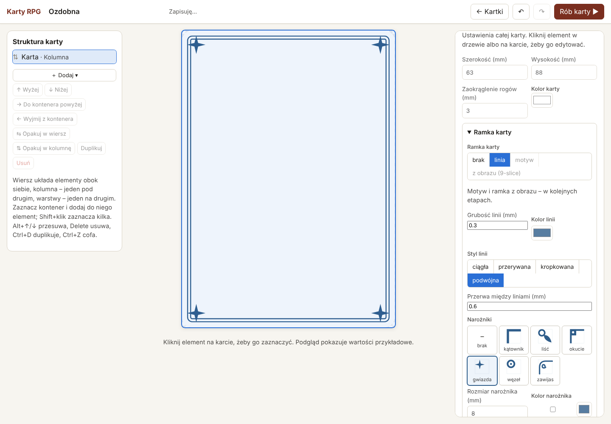
   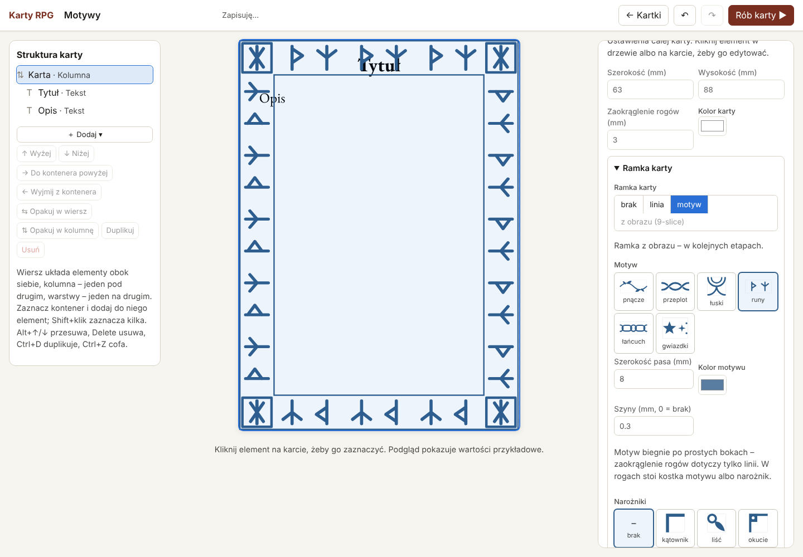
3. **Separator ozdobny**: **＋ Dodaj** → „Separator z zakończeniami” (albo zwykły „Separator” i w jego
   właściwościach: rysunek linia / motyw, zakończenia, środek, długość w mm lub %). Działa poziomo
   w kolumnie i pionowo w wierszu.
   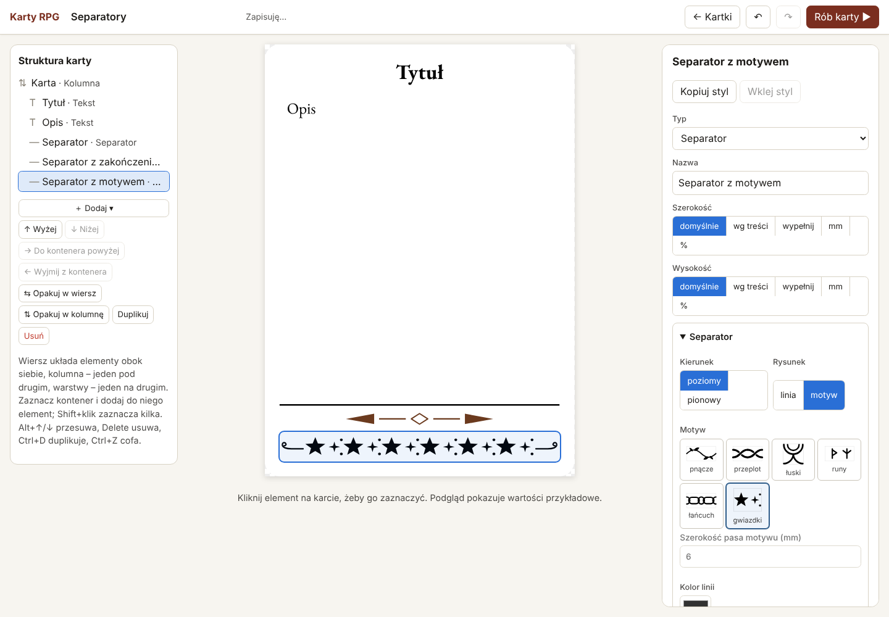
4. **Własne SVG i biblioteka**: link **„Biblioteka ozdobników”** w edytorze → **Importuj SVG…**. Plik jest
   sprawdzany (skrypty, obrazy i odwołania zewnętrzne są usuwane, tekst trzeba zamienić na krzywe,
   limit 512 KB). Wybierz, do czego element służy – kafelek motywu, narożnik, zakończenie, środek
   separatora, **kształt wartości** albo **ramka 9-slice** – i kolor: jednolity (kolorowalny) albo
   z pliku. Elementy są w projekcie i jadą z eksportem projektu oraz pliku szablonu.
   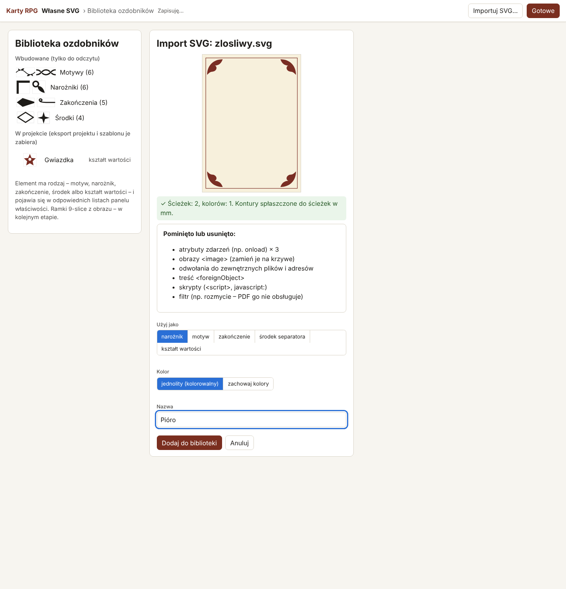
5. **Ramka 9-slice z PNG lub SVG**: w bibliotece wgraj obraz, ustaw cztery wcięcia (pola liczb albo
   przeciągane linie w podglądzie), sposób wypełnienia boków (rozciągnij / powtarzaj równo) i środka.
   Potem w „Ramka karty” wybierz **z obrazu (9-slice)** i grubość w mm. Aplikacja ostrzega,
   gdy obraz po przeskalowaniu ma poniżej 300 dpi.
   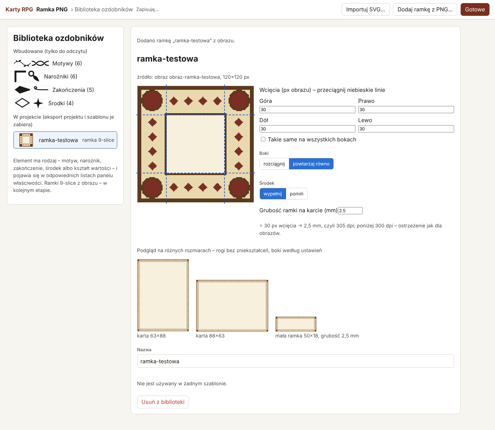
   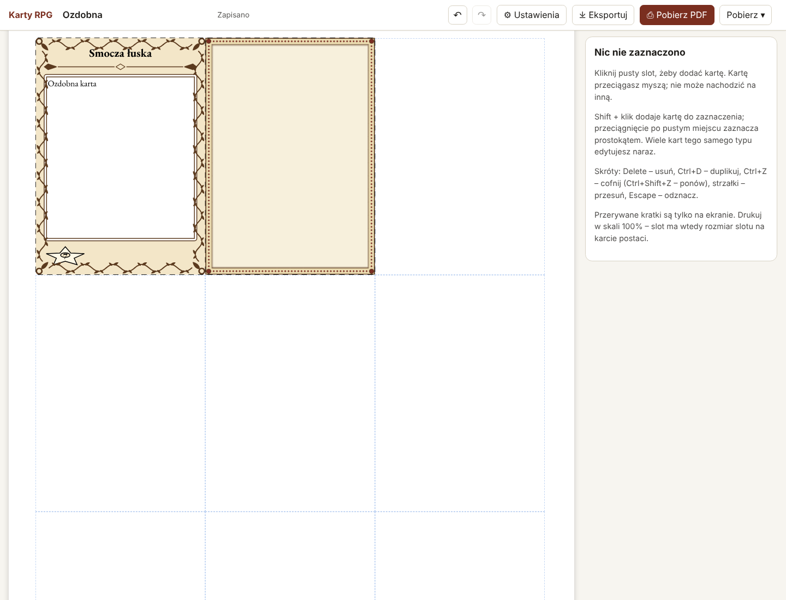

## Karty różnych rozmiarów

1. **Ustawienia** → „Rozmiary kart na kartce” → **mieszane**. Karty o różnych rozmiarach
   (np. 70×120, 63×88 i 44×68 mm) układają się na jednej stronie w pasach, a wspólne krawędzie mają
   jedną linię cięcia – wygodne cięcie na trymerze. Własny układ siatki jest wtedy wyłączony.
2. Opcje: kolejność **od największych** albo **własna** (przeciągnij kartę – zmienia się jej miejsce
   w kolejności, karty nigdy się nie nakładają), **obracanie o 90°**, gdy oszczędza papier,
   grupowanie kart tego samego rozmiaru, odstęp między kartami.
3. **Wolne miejsce** na kartce otwiera menu „Dodaj kartę w to miejsce”; szablon, który się tu nie
   zmieści, jest oznaczony, ale trafi w pierwsze pasujące miejsce.
   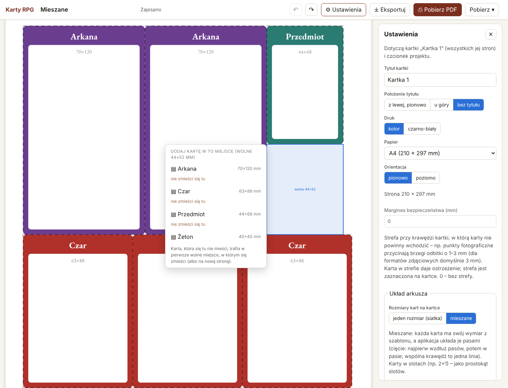
4. **Luz w slocie** (arkusze z perforacją, sloty większe niż karta): w „Układ arkusza” → „Karta
   w slocie”. Luz mówi, o ile karta może być mniejsza od slotu (domyślnie 1 mm, 0–5 mm) – np. karta
   63×88 mm w slocie 63,5×89 mm. Wybierz położenie (środek albo lewy górny róg), **tło do krawędzi
   slotu** (przy przesunięciu druku nie widać białego paska) i linie wokół slotu albo karty.
   Luz zapisuje się w „Moje układy”, więc preset arkusza zawiera już dobrany luz; sprawdzisz go
   **wydrukiem testowym**. Kartki sprzed tej funkcji zachowują dawną tolerancję 0,5 mm.
   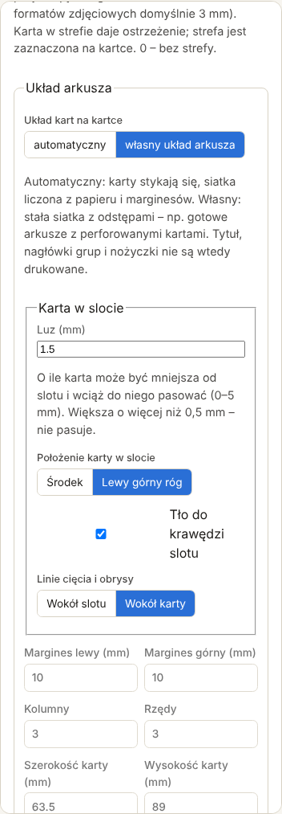

## Tryb swobodny

Pola układasz tam, gdzie chcesz – jak w programie graficznym. Nie trzeba go używać: kolumny i wiersze
działają jak dotąd.

1. W kreatorze wybierz układ **„Swobodny: pola w dowolnych miejscach”** albo zaznacz kontener
   (też korzeń karty) i w „Położenie” użyj **Zamień na swobodny** – nic się wtedy nie przesuwa.
   Kontener swobodny może być wewnątrz zwykłej kolumny, a w nim – zwykłe kolumny i wiersze.
2. **＋ Dodaj** i **przeciągnij pole** w podglądzie. Uchwyty w rogach i na bokach zmieniają rozmiar
   (Shift – proporcje), strzałki przesuwają o 0,5 mm (Shift – 5 mm). Pole przyciąga się do siatki
   i do krawędzi lub środków innych pól (Alt wyłącza); prowadnice widać tylko w edytorze.
   Jedno przeciągnięcie to jeden krok Cofnij.
   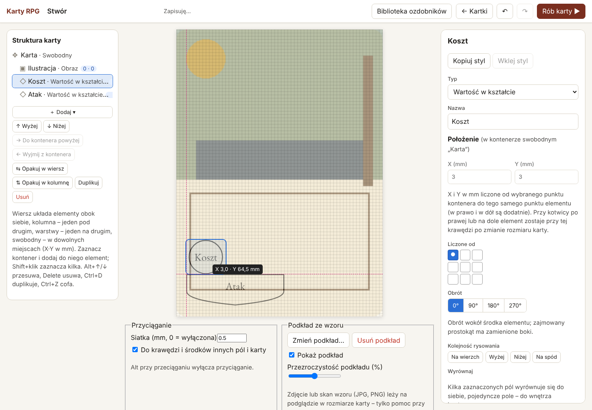
3. **Panel „Położenie”** robi to samo z klawiatury: X i Y w mm, punkt, od którego liczone jest
   położenie (np. prawy dolny róg – pole zostaje tam po zmianie rozmiaru karty), obrót 0/90/180/270°
   i kolejność rysowania (na wierzch / wyżej / niżej / na spód). Kilka zaznaczonych pól wyrównasz
   i rozłożysz równo jednym przyciskiem.
   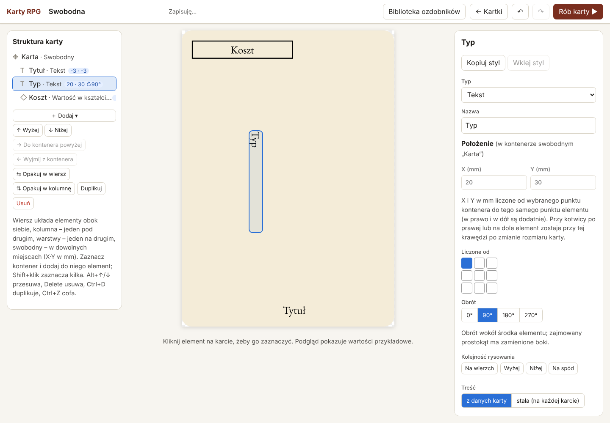
4. **Podkład ze wzoru**: **„Podkład…”** wczytuje zdjęcie lub skan karty, który leży pod podglądem
   (domyślnie w połowie przezroczysty, można go ukryć). Nie łapie kliknięć i **nie jest drukowany**.
   Przeciągnij pola na miejsca ze wzoru. Podkład jedzie z eksportem projektu, ale nie z plikiem szablonu.
   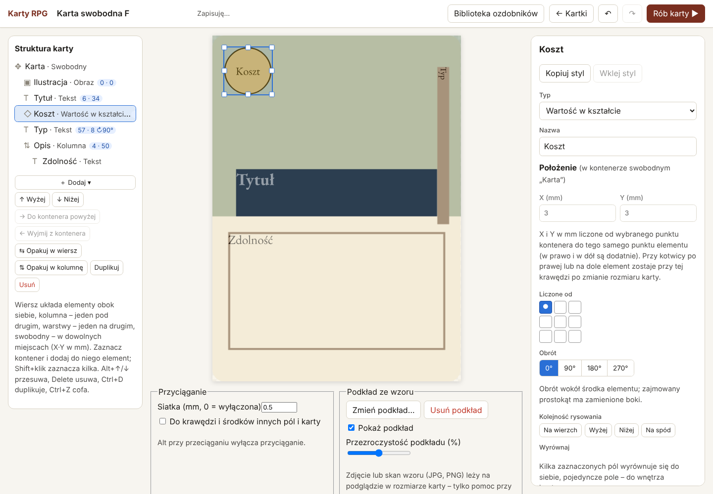

## Uruchomienie

Wymagany Node.js 22 lub nowszy.

```bash
npm install
```

```bash
npm run dev
```

Aplikacja działa pod adresem `http://localhost:5173/karty-rpg/`.

## Polecenia

| Polecenie               | Działanie                                            |
| ----------------------- | ---------------------------------------------------- |
| `npm run dev`           | serwer deweloperski                                  |
| `npm run build`         | sprawdzenie typów i budowanie do `dist/`             |
| `npm test`              | testy jednostkowe (Vitest)                           |
| `npm run e2e`           | testy end-to-end i wizualne (Playwright)             |
| `npm run test:nakladka` | nakładka arkuszy na oryginał (lokalnie, raport HTML) |
| `npm run lint`          | ESLint                                               |
| `npm run format:check`  | sprawdzenie formatowania (Prettier)                  |

Po zainstalowaniu przeglądarek poleceniem `npx playwright install chromium firefox webkit`,
`EKSPORT_PRZEGLADARKI=1 npm run e2e` uruchamia pełną regresję Chromium i testy eksportu
w silnikach Firefox oraz WebKit. Wynik dla natywnego Safari wymaga osobnego sprawdzenia na macOS.

Zrzuty ekranu w instrukcji (`public/instrukcja-zrzuty/<pl|en>/`) odświeżasz po zmianie wyglądu
ekranów poleceniem `ZRZUTY_INSTRUKCJI=1 npx playwright test testy/zrzuty-instrukcji.spec.ts`
(potem opcjonalnie `python3 narzedzia/kwantyzuj-zrzuty.py` zmniejsza pliki PNG).
Treść instrukcji jest w `instrukcja/index.html`; test `src/instrukcja/tresc.test.ts` pilnuje, żeby
nazwy przycisków w cudzysłowach zgadzały się z interfejsem, oraz stylu tekstu.

Wzorce wizualne (`*-snapshots/*-chromium-linux.png`) są dla Chromium na Linuksie (jak w CI); na innym
systemie porównania zrzutów nie przejdą – uruchamiaj e2e w kontenerze Linuksa albo zaktualizuj wzorce
lokalnie `npx playwright test --update-snapshots` (bez commitowania).

## Struktura

```
src/model    typy danych (wymiary w mm)
src/silnik   układ karty i renderowanie SVG
src/druk     arkusze, linie cięcia, PDF
src/dane     IndexedDB, eksport/import
src/ui       interfejs React
src/i18n     teksty interfejsu
instrukcja/  strona instrukcji (osobne wejście Vite; skrypt i style w src/instrukcja)
testy/       testy Playwright
docs/        plany i notatki
```

Pliki robocze, które nie mają trafić do repozytorium, trzymaj w `zasoby-prywatne/`.

## Test nakładania na oryginalne arkusze (lokalnie)

Oryginalne arkusze nie są w repozytorium (licencja). Żeby porównać nasze arkusze z oryginałem:

1. Skopiuj PDF do `zasoby-prywatne/referencje/Mausritter_kartyekwipunku.pdf`.
2. Opcjonalnie utwórz `zasoby-prywatne/referencje/nakladka.json`, np.:

   ```json
   {
     "plik": "Mausritter_kartyekwipunku.pdf",
     "strony": {
       "mausritter-arkusz-bron": 1,
       "mausritter-arkusz-wyposazenie": 2,
       "mausritter-arkusz-stany": 3
     },
     "czcionki": [
       {
         "rodzina": "Minion Pro",
         "wariant": "normalny",
         "plik": "../czcionki/MinionPro-Regular.otf"
       }
     ],
     "role": { "tresc": "Minion Pro" }
   }
   ```

3. `npm run test:nakladka` – raport HTML (`npx playwright show-report`) ma dla każdego arkusza
   obraz nakładki (nasze linie niebieskie, oryginał czerwony, zgodne czarne) i JSON
   z dopasowaniem: skala i przesunięcie w każdej osi oraz odchyłka każdej linii cięcia.
   Test przechodzi, gdy po dopasowaniu żadna linia nie odstaje o 0,3 mm lub więcej.

Bez plików test oryginału jest pomijany; w CI działa autotest na referencji syntetycznej.
Każdy dodany zasób zewnętrzny wpisz do [`LICENCJE.md`](LICENCJE.md).

## Licencja

Kod aplikacji jest udostępniony na licencji [MIT](LICENSE). Licencja nie obejmuje zasobów
w pakietach szablonów (czcionek, grafik, wzorów) – każdy z nich ma własne warunki opisane
w [`LICENCJE.md`](LICENCJE.md) i w pliku `LICENCJE.md` danego pakietu.
